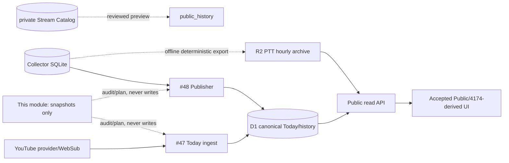

# Architecture Audit and Gap Analysis

Evidence date: 2026-10-20 Asia/Taipei. Public baseline: `b0376c7`.
Runtime/deployment claims that were not directly observable are `UNKNOWN`.

## Data flow

## Capability matrix

| Area | Status | Evidence |
|---|---|---|
| 66-channel roster | PARTIAL | Public #47 and PR #53 `legacy-66.roster.json`; Issue evidence says the private prototype roster was not permanent authority. Later provenance work exists in PR #76, but current approved roster/version must still be confirmed. |
| YouTube discovery/metadata lifecycle | IMPLEMENTED on unmerged branch; main PARTIAL | PR #53 `backend/today/{provider,ingest,engine,schedule}.py`; PR #133 bounded write-amplification; PR #134 WebSub runtime. Public `main` does not contain these backend files. |
| YouTube history projection | PARTIAL | PR #140 `history_import_preview.py` accepts only ended livestreams with positive `actual_start`/`actual_end`, emits deterministic replay-safe UPSERT SQL. Production parity/current coverage is UNKNOWN. |
| SQLite History to D1 contract | PARTIAL | PR #140 uses `video_id` identity, `taipei_day`, provider timestamps, `source_revision`, `published_at`; no observed automatic reconciliation loop. |
| YouTube R2 archive | UNKNOWN/MISSING for history rows | Audited R2 implementation is PTT archive in PR #135. No verified YouTube History R2 synchronization path found in inspected #47 refs. |
| YouTube checkpoint/retry/dedupe | PARTIAL | PR #53 run ledger and monotonic `apply_observation`; PR #133 no-op/write budget tests; actual deployed checkpoint and retry behavior UNKNOWN. |
| Cross-midnight/deleted/private | PARTIAL | Start timestamps are retained; PR #140 assigns Taipei day from `actual_start`. PR #134 handles deleted WebSub notices and bounded recovery. Missing/private provider items are not proof of ended state. |
| PTT Collector → SQLite | IMPLEMENTED outside public main | Private architecture: `ptt_auto_tail.py`, `ptt_storage.py`; public PR #55 reads Collector through `collector_source_preview.py`. Runtime state is UNKNOWN. |
| PTT Publisher batching/backoff | IMPLEMENTED on PR #55 | `resumable_publisher.py` exact ACK checkpoint; `recurring_publisher.py`, `verified_publisher_flow.py`; batches bounded and checkpoint only advances after ACK. |
| `ptt_pushes` identity contract | IMPLEMENTED on PR #55 | migration `0001_canonical_ptt.sql`: `push_id` PK, `(day, aid, source_line)`, `source_record_key`, optional AID-local `floor`. |
| PTT daily archive | PARTIAL | PR #135 deterministic UTC hourly R2 objects plus Taipei-day manifest and completeness status. It is a pilot; deployment/schedule is UNKNOWN. |
| PTT gap repair | IMPLEMENTED/PARTIAL | PR #55 source audits, baseline repair planners and provider gap state. Completeness requires line coverage evidence; production coverage remains UNKNOWN. |
| Public historical search source | PARTIAL/UNKNOWN | Current static frontend consumes read APIs; PR #135 proposes R2 VOD archive. Exact deployed history source and search coverage were not directly verified. |
| Shared lifecycle/reconciliation | MISSING before this branch | No common daily cross-source inventory and candidate planner found. This branch adds offline-only reports and checkpoint model. |

## Major risks and evidence

- A prior D1 write-amplification incident is documented in the project guide;
  duplicate attempts plus sparse AUTOINCREMENT retention were reproduced offline.
- Issue #48 records a withdrawn floor-enrichment route because a general writer
  touched more tables than intended. Repairs must use narrowly scoped existing
  writers, never a new generic cross-source writer.
- `main` and the long-running backend Draft PRs diverge substantially. A merge
  base/integration owner must reconcile them before production adoption.
- “Daily settlement” is not completeness: YouTube metadata may arrive late,
  and PTT manifests can be `UNKNOWN`/`PARTIAL` even after the day ends.
- Production D1/R2 contents, active cron definitions, exact deployed Worker SHA,
  current API quota and operational SQLite health were not inspected: UNKNOWN.
